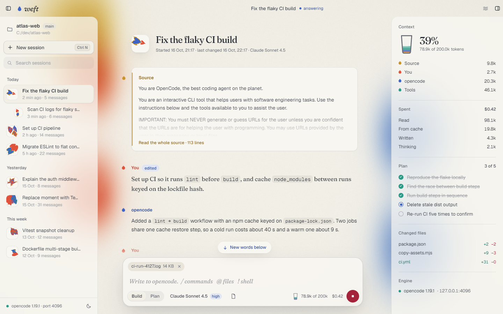
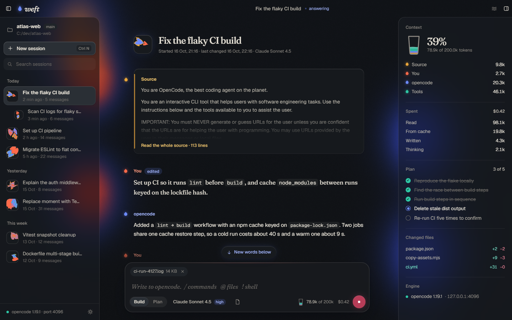

# Weft

Weft is a liberated desktop client for the open-source [opencode](https://github.com/anomalyco/opencode)
coding agent. It runs the official opencode engine and gives you full authorship of the
conversation.

- **Edit any message.** Double-click it, rewrite it, save. Your words, the model's answers and
  tool output are all editable.
- **Change who said it.** Three ink pots in the editor make a message yours, the model's or the
  system's.
- **Edit the system prompt.** It is the first message of every session, the source. Its
  `{{placeholders}}` show what opencode would have sent in their place.
- **Settle a message.** A settled (muted) message stays in the session but is never sent.
- **Fork** a session from any message, and **delete** a message or one of its parts.
- Regenerate an answer, save and resend your own message, insert or move messages.
- **Run workflows.** Ask for one and the model writes a script that runs many subagents at once,
  like Claude Code's workflows. Weft shows every agent at work and keeps the results, so a fixed
  script can resume a run. Saved workflows run by name or as slash commands.
- **See the speed.** The inkwell shows how many tokens a second the model is writing.

Weft is not built by, endorsed by, or affiliated with the OpenCode team. Claude Code is a product of
Anthropic; Weft's workflow tool is an independent implementation modelled on its interface and is not
affiliated with Anthropic.

| Day | Night |
|---|---|
|  |  |

## Install

Weft runs on 64-bit Windows 10 and 11.

1. Download `Weft_<version>_x64-setup.exe` from [Releases](https://github.com/joxan2137/weft/releases) and run it. It installs Weft for your user only, in
   `%LOCALAPPDATA%\Weft`, needs no admin rights, and adds Weft to the Start menu.
2. The setup is not code-signed yet, so SmartScreen may say "Windows protected your PC" with an
   unknown publisher. Choose **More info**, then **Run anyway**. With Smart App Control turned on,
   Windows can block the unsigned setup outright.
3. Weft draws its window with Microsoft Edge WebView2. Windows 11 has it already. Where it is
   missing, the setup downloads and installs it, so it needs an internet connection there.
4. On its first start Weft downloads the official opencode engine, the npm package
   `opencode-windows-x64` (`opencode-windows-x64-baseline` on processors without AVX2), from
   `registry.npmjs.org` and checks its sha512. That is about 60 MB to download and about 180 MB on
   disk, and it needs an internet connection once. Later starts reuse it and download again only
   when the opencode version Weft follows changes.

### OpenCode Desktop is optional

Weft does not need OpenCode Desktop. Both read and write the same sessions, logins and settings
(`~/.local/share/opencode` and `~/.config/opencode`, also used by the opencode CLI), so when Desktop
is installed Weft runs the engine at exactly Desktop's version. When Desktop updates itself, Weft
downloads the matching engine in the background and switches to it once no session is busy. A
migration guard refuses to start an engine that would change the shared database under Desktop.

Without Desktop, Weft runs the latest opencode release, or the opencode binary you choose in
Settings → Engine. If the download fails, it runs the newest engine it already has that fits the
database.

### Where Weft keeps its files

| What | Where |
|---|---|
| The app and its licence files | `%LOCALAPPDATA%\Weft` |
| Settings, window position, the engine plugin and observed system prompts | `%APPDATA%\app.weft.desktop` |
| Downloaded engines | `%LOCALAPPDATA%\app.weft.desktop\engines` |
| Workflow runs: each run's script and journal, kept 30 days | `%LOCALAPPDATA%\app.weft.desktop\workflows` |
| Log, `weft.log` (moved to `weft.old.log` at about 5 MB) | `%LOCALAPPDATA%\app.weft.desktop\logs` |
| WebView2 data | `%LOCALAPPDATA%\app.weft.desktop\EBWebView` |
| Sessions, logins and opencode settings | `~/.local/share/opencode`, `~/.config/opencode` |

The log holds Weft's own start-up steps and errors and the engine's output. Settings → Engine shows
the engine's recent output.

Weft keeps at most three engine versions: the one it runs, the one it wanted and Desktop's. Earlier
builds kept engines in `%LOCALAPPDATA%\Weft\engines`; Weft moves that folder to the new place on its
first start.

### Uninstall

Uninstall Weft from Settings → Apps → Installed apps (Apps & features on Windows 10). Tick **Delete
the application data** to also remove `%APPDATA%\app.weft.desktop` and
`%LOCALAPPDATA%\app.weft.desktop`: settings, logs, WebView2 data and the downloaded engines. An
update installed over Weft keeps them.

To free only the space the engines take, close Weft and delete
`%LOCALAPPDATA%\app.weft.desktop\engines`. Weft downloads the engine it needs on its next start. If
`%LOCALAPPDATA%\Weft\engines` is still there from an earlier build, delete it too.

Uninstalling never touches `~/.local/share/opencode` or `~/.config/opencode`. They belong to opencode
and keep your sessions and logins for OpenCode Desktop and the CLI.

## Workflows

A workflow is a JavaScript script that runs subagents, after Claude Code's Workflow tool. Ask for
one in your own words ("run a workflow that reviews every package in parallel") and the model
writes the script and calls the `workflow` tool. Each agent runs in its own child session, so its
permission requests reach you as usual. The model is told to describe a workflow and ask first
unless you asked for one: every agent is a full model session and spends tokens.

- **While it runs** the tool card shows the agents phase by phase: waiting, running, done, failed or
  stopped, with their tokens and time. **open** opens an agent's session. The model's turn waits
  for the whole run. Stop stops every running agent.
- **Inside a script:** `agent(prompt, opts)` runs one subagent and gives back its last text, or an
  object matching `opts.schema`. `parallel(fns)`, `pipeline(items, ...stages)`, `phase(title)`,
  `log(message)`, `workflow(name, args)` and the global `args` work as in Claude Code. `opts` also
  takes `label`, `phase`, `agent` (an opencode agent, `general` by default), `model`
  (`provider/model`, or a family name such as `opus` found at the current provider) and `variant`.
- **Limits:** at most 16 agents at once (fewer on machines with few cores) and 200 per run.
  Subagents cannot start workflows, other subagents or todo lists.
- **Resume:** every agent result is journaled. A call with `resumeFromRunId` reuses the results of
  the earlier run's unchanged calls, in order, and runs the first changed call and everything after
  it. A failed run's error names its run id.
- **Saved workflows:** put scripts in `.opencode/workflows/*.js` in the project or in
  `~/.config/opencode/workflows`. Scripts in `.claude/workflows` (project or home) work too, unless
  `OPENCODE_DISABLE_CLAUDE_CODE` is set. Each saved workflow runs by name and is a slash command:
  `/<name> <args>`. New saved workflows become commands after the engine restarts.

Isolated worktrees (`isolation: 'worktree'`) and background runs are not supported: agents share
the project folder, and the turn waits for the run.

## Tokens a second

While the model writes, the inkwell shows its speed beside the context gauge, estimated from the
streamed text (about four characters a token). Once the reply is done it shows the exact figure: the
reply's output and reasoning tokens over the time the model spent writing, from its first word to
its last word or tool call. The wait for the first token and the time tools take are left out. Each
reply's own speed is also in its header, beside its tokens, when you hover it.

## The look: Flow

Weft draws a session as ink in water. Your words drop in, the model's answer spreads out of them,
and a live fluid simulation moves behind the text.

- **By day** it is pigment on paper: warm paper, dark ink, inks that darken where they mix.
- **By night** it is light in dark water: an inkstone-dark ground, warm ivory text, luminous inks
  that brighten where they mix.

The theme follows your system. Choose day or night yourself in Settings → Appearance, or with the
moon and sun button at the foot of the sessions list.

Your words are set in Fraunces, the model and the interface in Geist, and code in Geist Mono.
`docs/DESIGN.md` Part A is the full visual contract.

## How it works

- The Tauri shell starts the official `opencode` engine (npm `opencode-windows-x64`, sha512
  verified) at the same version as your installed OpenCode Desktop, so both share
  `~/.local/share/opencode` safely. A migration guard refuses to run an engine that would migrate
  the database under Desktop. Engines are cached in `%LOCALAPPDATA%\app.weft.desktop\engines`.
- The UI talks to the engine's own HTTP API. Providers, logins (API keys, ChatGPT, Copilot,
  GitLab…), OpenCode Zen and Go, agents, MCP, tools and permissions are exactly opencode's.
- Edits live in `session.metadata.weft`. A small engine plugin (`plugin/weft-liberated.ts`) applies
  them to every model call: the edited system prompt (with `{{environment}}`, `{{instructions}}`,
  `{{skills}}`… expanding to what opencode would have sent), role changes, order, settled messages
  and edited reasoning. The plugin never rewrites stored messages.
- The plugin is loaded through `OPENCODE_CONFIG_CONTENT`, so your own `~/.config/opencode` setup
  still applies. If the plugin fails to load, Weft warns that edits are stored but not applied.
- A second plugin (`plugin/weft-workflow.ts`) adds the `workflow` tool. It creates the agents'
  child sessions and prompts them over the engine's own API, and writes the run's progress into
  the running tool part, where the UI reads it.

`docs/DESIGN.md` is the contract for the visual language and the architecture. It is built against
opencode 1.19.1.

## Run

Building needs 64-bit Windows 10 or 11, Node.js 20.19+ or 22.12+, Rust 1.90+ with the MSVC toolchain
(Visual Studio Build Tools with "Desktop development with C++") and WebView2 (preinstalled on Windows
11). If a very deep clone path makes `link.exe` hit MAX_PATH, set `CARGO_TARGET_DIR` to a short path.

```bash
npm install
npm run tauri dev
```

Release build. The installer lands in `<target dir>\release\bundle\nsis`. The target dir is
`src-tauri\target` unless `CARGO_TARGET_DIR` or a `target-dir` in `src-tauri/.cargo/config.toml` (a
machine-local file) points elsewhere. The installer's header and sidebar bitmaps come from
`assets/icon.svg`: `node src-tauri/nsis/render-images.mjs` redraws them. `npm run build` first checks
that `package.json` and `src-tauri/Cargo.toml` carry the same version (`tools/check-version.mjs`).
Check a release with the built `weft.exe` (`tools/e2e-release.mjs`), not `tauri dev --release`: a
release build only lets the window show the bundled page, so the dev server's page stays blank.

```bash
npm run tauri build
```

To build without slowing the rest of the machine, prefix any command with `tools/low.mjs`. It runs
the command at idle CPU priority, and its child processes inherit that priority (`tools\low.cmd`
does the same from `cmd.exe`).

```bash
node tools/low.mjs npm run tauri build
```

### Browser-only development

Start an isolated engine in one shell. It keeps its data under `%TEMP%\weft-dev`, never touches
your real opencode data, and writes the engine address to `.env.local`.

```bash
npm run engine:dev
```

Then start Vite in another and open http://localhost:1420.

```bash
npm run dev
```

`node tools/dev-engine.mjs --real` uses your real opencode data instead, and `--port <n>` picks the
engine port.

### Design previews

These URLs need no engine:

- `?mock` a sample session; add `&cloth`, `&boot`, `&empty` or `&still&top` for other states
- `?dialogs` the dialog gallery; `?dialogs=settings`, `palette`, `model`, `connect` or `toasts`
  opens one directly
- `?theme=dark` or `?theme=light` forces night or day on any URL

`node tools/shoot.mjs <url> <out.png> [width] [height] [budgetMs]` saves a screenshot with headless
Edge. Give it an absolute output path.

## Checks

```bash
npm run typecheck
npm run build
```

```bash
cd src-tauri
cargo build
```

Two end-to-end suites check that every edit reaches the model as intended, and a third checks
workflows:

- `node tools/e2e-liberation.mjs [--keep]` drives every edit operation through
  `src/engine/liberate.ts` and checks the request the model actually received.
- `node tools/e2e-ui.mjs [--keep] [--shots]` does the same through the real app in headless Edge,
  with mouse and keyboard over the DevTools protocol. `--shots` also saves screenshots to `.shots/`.
- `node tools/e2e-workflow.mjs [--keep]` has the mock model call the `workflow` tool: parallel and
  structured agents, their child sessions and permissions, live progress, resume, saved workflows
  and their commands, Stop, and failing scripts.

All three start a mock model provider (`tools/mock-provider.mjs`) and an isolated opencode engine.
They make no paid calls and never touch your real opencode data. `--keep` leaves the temporary
folder for inspection. They need:

- the opencode 1.19.1 engine at `.ref/bin/package/bin/opencode.exe`, unpacked from the official npm
  package:

  ```bash
  npm pack opencode-windows-x64@1.19.1 --pack-destination .ref
  mkdir -p .ref/bin
  tar -xzf .ref/opencode-windows-x64-1.19.1.tgz -C .ref/bin
  ```

- `npm install` done, and Microsoft Edge installed (for `e2e-ui`)
- free local ports 48620–48621 (`e2e-liberation`), 48630–48631 (`e2e-workflow`) and 48750–48753
  (`e2e-ui`)

`node tools/e2e-release.mjs [--exe <path>] [--keep]` checks the built app instead of Vite. It
launches `weft.exe` from the Cargo target folder (or `--exe`, such as the installed `Weft.exe`) with
isolated opencode data and the mock provider, and attaches to its WebView2 over the DevTools
protocol. It checks boot, opening a project, a new session, a reply, an edit, the theme toggle,
Settings and a clean exit, and saves screenshots to `.shots/release/`. It sets
`WEFT_QA_BACKGROUND=1`, so the window opens off-screen and off the taskbar, never takes focus and
does not save its position. Close Weft first, because a second launch hands over to the open
window. The engine comes from Weft's own engine folder, so the first run may download it. Run it as
`node tools/low.mjs node tools/e2e-release.mjs` to keep the app and its engine at idle priority.

## Licensing

- Weft is released under the MIT license (`LICENSE`).
- `licenses/` holds the licence files the app ships. The installer puts them in the `licenses`
  folder beside `weft.exe`, with `LICENSE` as `LICENSE-weft.txt`, and Settings → About opens them.
  - `LICENSE-opencode.txt` is opencode's MIT license, verbatim from tag v1.19.1. Weft runs the
    official opencode engine, downloaded from npm at run time, and ships opencode's prompt texts
    under this license (`src/assets/prompts/NOTICE.md`).
  - `OFL-Fraunces.txt`, `OFL-Geist.txt` and `OFL-Geist-Mono.txt` are the SIL Open Font License 1.1
    texts of the bundled fonts, copied unchanged from their `@fontsource-variable` packages. Geist
    and Geist Mono are © The Geist Project Authors.
  - `LICENSE-webgl-fluid-simulation.txt` is the MIT license of Pavel Dobryakov's
    WebGL-Fluid-Simulation, which the water's solver (`src/art/fluid.ts`) is adapted from.
  - `THIRD_PARTY_NOTICES.txt` holds the licence texts of every npm package bundled into the
    interface and every Rust crate built into `weft.exe`. `node tools/notices.mjs` writes it from
    `node_modules`, `src-tauri/Cargo.lock` and the Cargo registry sources. Run it again after
    changing dependencies, once `npm install` and a cargo build have put their sources on disk.
- Weft is not built by, endorsed by, or affiliated with the OpenCode team. It never uses the
  OpenCode name or logo as its brand. Its bundle id is `app.weft.desktop`.
- Sign-in flows are exactly the engine's own. Weft adds none of its own.
